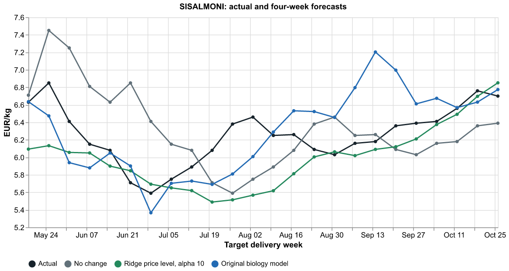
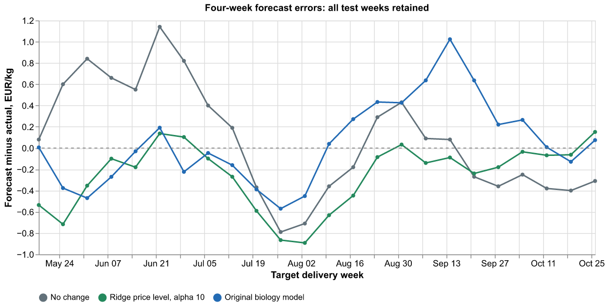

# SISALMONI v2: retrospective results

A separate short-history experiment using genuine SISALMONI 3–6 kg EUR/kg observations only.

**Recommended model: No change (`rw`).**
The frozen development-selected challenger is `ridge_level_a10`; the frozen strongest development baseline is `rw`.
The challenger changes final four-week MAE by +4.65% relative to the strongest eligible baseline on these same test dates (positive means improvement).
The 10% objective with supporting paired uncertainty evidence is not met. No final result was used to retune models.

The selected candidate predicts the EUR price level directly, using the six compact price/calendar inputs and feature groups []. Its alpha-10 Ridge penalty and training-only scaling constrain coefficient instability. Direct level forecasts also avoid exponential amplification of a fitted log return. This explains its design benefit, not a claim of reliable future outperformance.
The no-change improvement on this segment is +33.57%. The recommended baseline is the one selected in development, not a baseline re-picked using final outcomes. The strongest observed final baseline (`old_c1`) is reported separately and descriptively.

## Primary comparison: four weeks

All models below use the same 24 target weeks, 2026-W21–2026-W44. Earlier full-history scores are not comparison baselines.

| Model | MAE EUR/kg | RMSE EUR/kg | Log MAE | Direction accuracy | Coverage | vs no change |
| --- | --- | --- | --- | --- | --- | --- |
| Simple AR(1) | 0.459 | 0.539 | 0.073 | 37.5% | 24/24 | -4.4% |
| 50/50 Ridge + no change | 0.365 | 0.448 | 0.058 | 75.0% | 24/24 | +17.0% |
| Frozen forecast policy | 0.292 | 0.394 | 0.048 | 79.2% | 24/24 | +33.6% |
| Original price model | 0.352 | 0.453 | 0.057 | 62.5% | 24/24 | +19.8% |
| Original market model | 0.330 | 0.417 | 0.055 | 79.2% | 24/24 | +25.0% |
| Original biology model | 0.306 | 0.391 | 0.049 | 83.3% | 24/24 | +30.3% |
| Ridge + biology | 0.340 | 0.413 | 0.055 | 70.8% | 24/24 | +22.7% |
| Ridge + exports | 0.315 | 0.398 | 0.051 | 75.0% | 24/24 | +28.4% |
| Ridge + FX | 0.314 | 0.408 | 0.051 | 83.3% | 24/24 | +28.5% |
| Ridge price level, alpha 10 | 0.292 | 0.394 | 0.048 | 79.2% | 24/24 | +33.6% |
| Ridge price level, alpha 100 | 0.237 | 0.299 | 0.038 | 79.2% | 24/24 | +46.1% |
| Ridge log change, alpha 10 | 0.248 | 0.345 | 0.041 | 75.0% | 24/24 | +43.6% |
| Ridge log change, alpha 100 | 0.317 | 0.411 | 0.051 | 75.0% | 24/24 | +27.9% |
| No change | 0.440 | 0.515 | 0.070 | no call | 24/24 | +0.0% |

The unselected `ridge_level_a100` configuration scored 0.237 EUR/kg on this segment. It was not the development-selected challenger. This is a secondary observation for future research; it is not used to change the frozen model or claim a validated winner.

## Paired uncertainty

Negative EUR/kg differences favor the selected challenger. Blocks resample the same consecutive weeks for both models, preserving pairing and short-range dependence. The 24-week segment supplies only six four-week or three eight-week blocks; these intervals are approximate, not strong independent confirmation. They condition on the frozen selection and do not remove the effects of earlier historical-data inspection or establish robustness to new regimes.

| Baseline | Block weeks | Mean MAE difference EUR/kg | 95% interval | Improvement | 95% improvement interval |
| --- | --- | --- | --- | --- | --- |
| No change | 4 | -0.148 | [-0.350, +0.030] | +33.6% | [-7.2%, +66.7%] |
| No change | 8 | -0.148 | [-0.315, +0.012] | +33.6% | [-3.3%, +57.8%] |
| Original biology model | 4 | -0.014 | [-0.235, +0.178] | +4.7% | [-71.8%, +57.7%] |
| Original biology model | 8 | -0.014 | [-0.220, +0.146] | +4.7% | [-58.7%, +55.2%] |

## Development and selection

The earliest 93 target weeks are development; the latest 24 are reserved for the final retrospective segment. Selection uses only development labels public by 2 April 2026 (through 2026-W13), before the first h=8 final forecast. W14–W20 are an explicit selection gap. Training can subsequently expand as observations become public, with frozen configurations.
Each fixed candidate is validated using expanding training windows and train-only scaling. The additional chronological development policy chooses from earlier validation errors only after those labels were published; it starts with no change until eight released observations exist. `selection.json` records the final pre-test choice and input/code hashes.

| Development candidate | MAE EUR/kg | n |
| --- | --- | --- |
| Chronological selection policy | 0.619 | 45 |
| Simple AR(1) | 0.714 | 45 |
| 50/50 Ridge + no change | 0.665 | 45 |
| Original price model | 1.226 | 45 |
| Original market model | 1.601 | 45 |
| Original biology model | 5.480 | 45 |
| Ridge + biology | 0.672 | 45 |
| Ridge + exports | 0.677 | 45 |
| Ridge + FX | 0.650 | 45 |
| Ridge price level, alpha 10 | 0.540 | 45 |
| Ridge price level, alpha 100 | 0.758 | 45 |
| Ridge log change, alpha 10 | 0.643 | 45 |
| Ridge log change, alpha 100 | 0.658 | 45 |
| No change | 0.698 | 45 |

FX, export and biology comparisons all use the same alpha-100 log-change Ridge price core. A group is eligible only if its development MAE improves that core by at least 2%. Decisions and eligibility are recorded in `selection.json`; no unsupported group is added to the selected model.

## Secondary horizons

These were predefined secondary analyses, not a new model-selection step.

| h | Selected challenger MAE | No-change MAE | Old c1 MAE | Challenger vs no change |
| --- | --- | --- | --- | --- |
| 2 | 0.220 | 0.268 | 0.467 | +17.9% |
| 3 | 0.246 | 0.377 | 0.439 | +34.7% |
| 4 | 0.292 | 0.440 | 0.306 | +33.6% |
| 5 | 0.340 | 0.475 | 0.501 | +28.4% |
| 6 | 0.343 | 0.534 | 0.760 | +35.8% |
| 7 | 0.303 | 0.560 | 1.042 | +46.0% |
| 8 | 0.298 | 0.607 | 0.951 | +51.0% |

## Diagnosis and limits

The original OLS model had 29 columns and as few as 30 training observations, with rank deficiency, severe collinearity and exponential amplification of large log predictions. The compact Ridge models use six price/calendar inputs and positive regularization, with means and scales fitted within each training window. The simple ensemble adds no fitted parameters. Direct level and log-change targets are tested explicitly. See `DIAGNOSIS.md` for measured evidence and hypotheses.
This experiment reduces model instability; that does not guarantee an advantage over no change. Only 117 index prices and 24 final target weeks are available, with revised exogenous inputs and approximate public-release dates. The history and prior SISALMONI scores had already been examined, so this is retrospective. A future genuinely unseen evaluation is needed before claiming reliability.
The target is the pure EUR benchmark, not the blended 2024 NOK field. Forecast issue dates are normally Thursday of the following week; h counts delivery-week shifts, not h complete weeks after that issue date. Features at every historical origin use their own publication-filtered snapshot. No Nasdaq or SSB prices fill target history, and no arbitrary forecast clipping or difficult-week deletion is used.

## Reproduce and inspect

```sh
python -m price.sisalmoni_v2 run --raw-dir data/raw/sisalmoni
python -m price.sisalmoni_v2_report --raw-dir data/raw/sisalmoni
```

The runner refuses to overwrite a completed final evaluation. Prediction Parquets, `comparison.csv`, `development_comparison.csv`, `paired_errors.csv`, `paired_uncertainty.json`, `selection.json`, `decision.json` and provenance retain the evidence. Original SSB and v1 outputs are preserved.

See `README.md` for the verified interpreter, dependency snapshot and a fresh-output replay command. `selection.initial.json` preserves the first freeze; a documented pre-test amendment tightened the CLI input-path guard without changing configurations, selections, inputs, dates or development predictions.





Sources: [SISALMONI definition](https://www.sitagri.com/sitagri-salmon-index/), [verified price source](../sisalmoni/SOURCES.md), [Ridge objective](https://scikit-learn.org/stable/modules/generated/sklearn.linear_model.Ridge.html), [circular block resampling](https://bashtage.github.io/arch/bootstrap/generated/arch.bootstrap.CircularBlockBootstrap.html).
